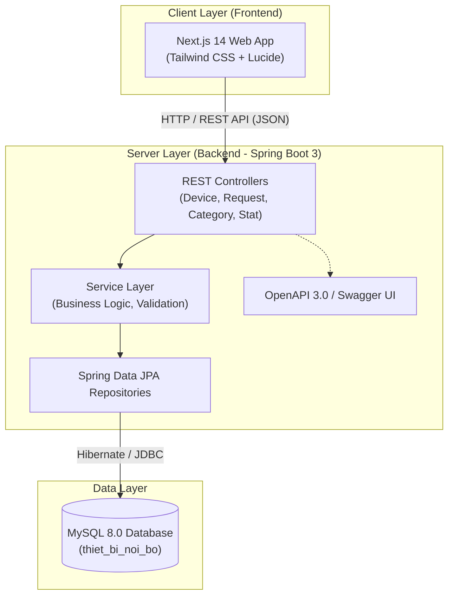
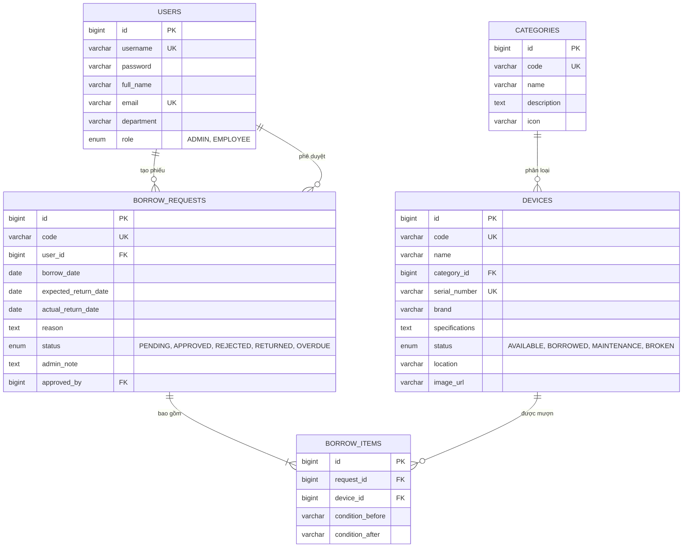

# HỆ THỐNG QUẢN LÝ THIẾT BỊ NỘI BỘ (INTERNAL DEVICE MANAGEMENT)

> **Môn học / Học phần:** Chuyên Đề 2 (CD2) / Phát Triển Phần Mềm  
> **Sinh viên thực hiện:** Trương Đàm Công Quý  
> **Công nghệ áp dụng:** Spring Boot 3 (Java 17), Next.js 14, Tailwind CSS, MySQL 8.0, Docker  

---

## 📌 LIÊN KẾT NỘP BÀI (SUBMISSION LINKS)

| Thành phần | Đường dẫn (URL) | Ghi chú |
| :--- | :--- | :--- |
| **Link GitHub (Source Code)** | [https://github.com/quytruong1404/quan-ly-thiet-bi-noi-bo](https://github.com/quytruong1404/quan-ly-thiet-bi-noi-bo) | Mã nguồn trọn vẹn Frontend & Backend |
| **Link Frontend (Production Web)** | [https://frontend-eight-beta-68.vercel.app](https://frontend-eight-beta-68.vercel.app) | Triển khai trên nền tảng Vercel (Live) |
| **Link Backend (REST API)** | [https://quan-ly-thiet-bi-noi-bo.onrender.com](https://quan-ly-thiet-bi-noi-bo.onrender.com) | Triển khai trên nền tảng Cloud Render |
| **Link Tài Liệu Swagger UI** | [https://quan-ly-thiet-bi-noi-bo.onrender.com/swagger-ui/index.html](https://quan-ly-thiet-bi-noi-bo.onrender.com/swagger-ui/index.html) | Kiểm thử trực tiếp 15+ API endpoints |

---

## 📖 1. GIỚI THIỆU ĐỀ TÀI

**Hệ thống Quản lý Thiết bị Nội bộ** được thiết kế nhằm số hóa toàn diện quy trình kiểm kê, điều chuyển, cấp phát và thu hồi trang thiết bị văn phòng (Laptop, Màn hình, Máy chiếu, Thiết bị kiểm thử mobile, Phụ kiện kỹ thuật) trong doanh nghiệp:
- **Quản lý danh mục & tình trạng tài sản:** Theo dõi thời gian thực số lượng thiết bị *Sẵn sàng trong kho (AVAILABLE)*, *Đang cho mượn (BORROWED)*, *Đang bảo trì (MAINTENANCE)* và *Hỏng hóc (BROKEN)*.
- **Phân hệ Nhân viên:** Tra cứu danh mục, kiểm tra thiết bị khả dụng và tạo phiếu đăng ký mượn trực tuyến kèm thời hạn và lý do công tác.
- **Phân hệ Quản trị viên (Admin):** Thẩm định và xét duyệt hoặc từ chối phiếu mượn; tiếp nhận thiết bị hoàn trả, đánh giá hiện trạng máy khi nhập lại kho.
- **Báo cáo & Thống kê thông minh:** Biểu đồ xu hướng mượn theo tháng, tỷ lệ trả đúng hạn, cơ cấu thiết bị theo danh mục và top thiết bị có tần suất sử dụng cao nhất.

---

## 🏗️ 2. KIẾN TRÚC HỆ THỐNG (SYSTEM ARCHITECTURE)



---

## 🗄️ 3. SƠ ĐỒ THỰC THỂ CƠ SỞ DỮ LIỆU (ERD)



---

## 📡 4. DANH MỤC API ENDPOINTS CHÍNH

| Method | Endpoint | Mô tả chức năng | Quyền hạn |
| :--- | :--- | :--- | :--- |
| `POST` | `/api/auth/login` | Đăng nhập tài khoản | Public |
| `GET` | `/api/auth/users` | Lấy danh sách nhân viên công ty | All |
| `GET` | `/api/devices` | Lấy danh sách thiết bị (hỗ trợ search, filter status & category) | All |
| `GET` | `/api/devices/{id}` | Chi tiết thông tin 1 thiết bị | All |
| `POST` | `/api/devices` | Thêm mới thiết bị vào kho | Admin |
| `PUT` | `/api/devices/{id}` | Cập nhật thông số kỹ thuật thiết bị | Admin |
| `PATCH`| `/api/devices/{id}/status`| Chuyển trạng thái nhanh (Sẵn sàng/Bảo trì/Hỏng) | Admin |
| `GET` | `/api/categories` | Lấy danh mục các loại thiết bị | All |
| `POST` | `/api/categories` | Thêm mới danh mục thiết bị | Admin |
| `GET` | `/api/borrow-requests` | Lấy toàn bộ phiếu mượn (lọc PENDING, APPROVED, RETURNED) | Admin |
| `GET` | `/api/borrow-requests/user/{userId}` | Lấy lịch sử phiếu mượn của nhân viên | Employee |
| `POST` | `/api/borrow-requests` | Nhân viên tạo mới phiếu đăng ký mượn | Employee |
| `POST` | `/api/borrow-requests/{id}/approval` | Admin xét duyệt hoặc từ chối phiếu mượn | Admin |
| `POST` | `/api/borrow-requests/{id}/return` | Admin xác nhận hoàn trả & kiểm tra tình trạng máy | Admin |
| `GET` | `/api/statistics` | Lấy toàn bộ số liệu thống kê cho Dashboard | Admin |

---

## 👥 5. TÀI KHOẢN TRẢI NGHIỆM HỆ THỐNG (DEMO ACCOUNTS)

| Vai trò | Tên đăng nhập | Mật khẩu | Họ và tên | Phòng ban |
| :--- | :--- | :--- | :--- | :--- |
| **Quản Trị Viên (Admin)** | `admin` | `123456` | Quản Trị Viên Hệ Thống | Ban Quản Trị & IT |
| **Nhân viên (Employee)** | `quy.truong` | `123456` | Trương Đàm Công Quý | Phòng Phát Triển Phần Mềm |
| **Nhân viên (Employee)** | `tan.thanh` | `123456` | Nguyễn Thanh Tấn | Phòng Kiểm Thử (QA/QC) |

---

## 🚀 6. HƯỚNG DẪN CÀI ĐẶT & CHẠY DỰ ÁN TẠI LOCAL

### Cách 1: Khởi động tức thì bằng Docker Compose (Khuyên dùng)
```bash
# Clone dự án từ GitHub
git clone https://github.com/quytruong1404/quan-ly-thiet-bi-noi-bo.git
cd quan-ly-thiet-bi-noi-bo

# Khởi động trọn bộ MySQL + Spring Boot + Next.js bằng 1 câu lệnh duy nhất
docker-compose up --build -d
```
- Giao diện người dùng: `http://localhost:3000`
- API Backend: `http://localhost:8080/api`
- Tài liệu Swagger UI: `http://localhost:8080/swagger-ui/index.html`

---

### Cách 2: Khởi động thủ công từng phần

#### 1. Cơ sở dữ liệu MySQL
1. Khởi động MySQL trên cổng `3306`.
2. Mở file [**`database/schema.sql`**](file:///database/schema.sql) và thực thi để tạo cấu trúc bảng cùng toàn bộ 10+ thiết bị mẫu.

#### 2. Máy chủ Spring Boot Backend
```bash
cd backend
# Chạy với Maven Wrapper
./mvnw clean spring-boot:run
# Hoặc trên Windows PowerShell:
.\mvnw.cmd clean spring-boot:run
```
Máy chủ backend sẽ lắng nghe tại `http://localhost:8080`.

#### 3. Giao diện Next.js Frontend
```bash
cd frontend
npm install
npm run dev
```
Truy cập ứng dụng tại `http://localhost:3000`.

---

## 🌐 7. HƯỚNG DẪN TRIỂN KHAI CLOUD (DEPLOYMENT)

### A. Triển khai Frontend lên Vercel
1. Đăng nhập [Vercel](https://vercel.com) bằng tài khoản GitHub `quytruong1404`.
2. Bấm **Add New Project** $\rightarrow$ Chọn repository `quan-ly-thiet-bi-noi-bo`.
3. Trong mục **Root Directory**, chọn thư mục `frontend`.
4. Điền biến môi trường: `NEXT_PUBLIC_API_URL` trỏ tới link Render Backend.
5. Bấm **Deploy**. Sau 60 giây, website sẽ online tại `https://quan-ly-thiet-bi-noi-bo.vercel.app`.

### B. Triển khai Backend lên Render.com
1. Đăng nhập [Render](https://dashboard.render.com).
2. Tạo mới **Web Service** $\rightarrow$ Kết nối repository `quan-ly-thiet-bi-noi-bo`.
3. Chọn môi trường **Docker** (Render sẽ tự động đọc [**`backend/Dockerfile`**](file:///backend/Dockerfile)).
4. Đặt tên service: `quan-ly-thiet-bi-noi-bo`.
5. Bấm **Deploy Web Service**.
